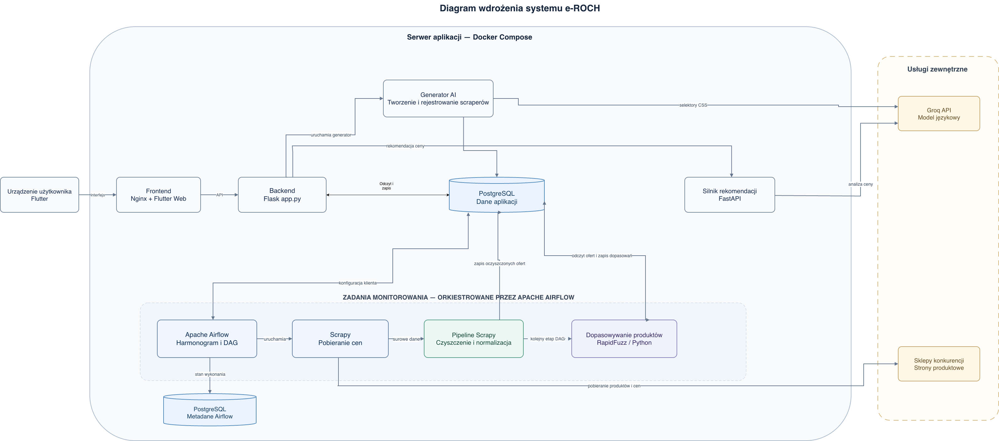
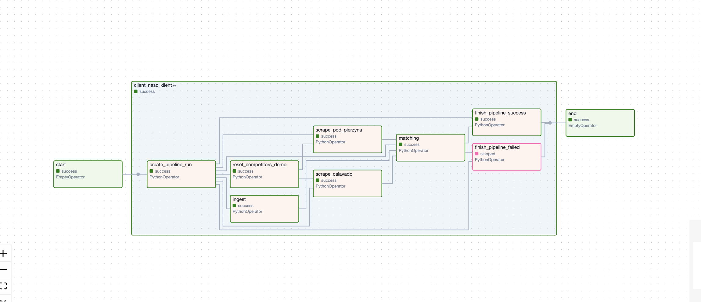
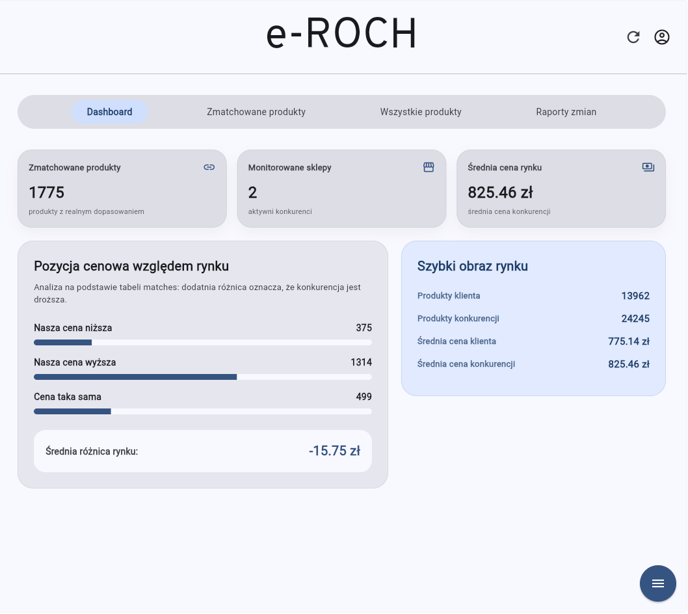

# e-ROCH: E-commerce Data Pipeline & AI Price Monitoring System

Zaawansowany, rozproszony system analityczny klasy E-commerce do automatycznego monitorowania cen konkurencji, analizy rynku oraz inteligentnej rekomendacji cenowej. Projekt pokrywa pełen cykl życia inżynierii danych (**Data Engineering Lifecycle**): od autonomicznej ekstrakcji wspieranej przez LLM, przez transformację i ładowanie (ETL), aż po orkiestrację procesów i udostępnianie danych przez API.

---



---

## 🏗️ Architektura Systemu

System oparty jest na architekturze mikrousługowej, w pełni skonteneryzowanej przy użyciu Dockera, składającej się z 5 głównych filarów:

* **Moduł Autonomicznej Ekstrakcji Danych (Scraper AI):** Zbudowany w oparciu o framework **Scrapy**. Działa w trybie klasycznym (dedykowane pająki) oraz autonomicznym (integrującym się z modelami językowymi przez API Groq do analizy Sitemaps, odszumiania DOM i generowania selektorów CSS).
* **Orkiestracja (Apache Airflow):** Centralny punkt zarządzania potokami ETL. Koordynuje DAG-i, zapewniając harmonogramowanie, izolację zadań, automatyczne ponawianie po awariach oraz wywoływanie procesorów transformujących.
* **Data Cleansing & Product Matching:** Procesory wewnątrz Airflow odpowiadają za normalizację danych (formaty walut, typowanie) oraz łączenie ofert konkurencji z własnym katalogiem przy użyciu analizy atrybutów i algorytmów dopasowywania rozmytego (*fuzzy matching*).
* **Warstwa Składowania Danych (PostgreSQL & Redis):** PostgreSQL utrzymuje dwie instancje (metadane Airflow oraz główną hurtownię danych). Redis pełni rolę brokera wiadomości oraz warstwy cache, wspierając kolejkowanie zadań dla Airflow.
* **Silnik Rekomendacyjny (XAI) & API:** Backend we **Flasku** dostarcza interfejs REST API. Zintegrowany silnik oblicza sugerowaną cenę, a następnie wykorzystuje model LLM do wygenerowania uzasadnienia biznesowego (Explainable AI). Wyniki prezentowane są w interfejsie napisanym we **Flutterze**.

---

## ⚙️ Data Pipeline Flow (ETL)

Poniżej przedstawiono przykładowy graf skierowany acykliczny (DAG) z Apache Airflow obrazujący orkiestrację zadań ETL, w tym ekstrakcję danych ze sklepów oraz proces dopasowywania produktów (*matching*):



1. **Extract:** Pobranie danych przez Scrapy (dedykowane parsery lub fallback AI).
2. **Transform:** Czyszczenie danych HTML, normalizacja walut, rzutowanie typów, kompresja i deduplikacja.
3. **Load:** Zasilenie głównej bazy PostgreSQL gotowymi strukturami relacyjnymi.
4. **Serve:** Kalkulacja delt cenowych, identyfikacja produktów nieaktywnych (*stale products*), generowanie raportów zmian i serwowanie agregatów analitycznych.

---

## 🚀 Uruchomienie lokalne (Getting Started)

### Wymagania wstępne
* Zainstalowany **Docker** oraz **Docker Compose**

### Krok 1: Klonowanie repozytorium
```bash
git clone https://github.com/Jhonny1178/Ecommerce_app_for_monitoring_competition_prices.git
cd Ecommerce_app_for_monitoring_competition_prices
```

### Krok 2: Konfiguracja środowiska
Utwórz plik `.env` w głównym katalogu projektu i uzupełnij wymagane klucze na podstawie pliku `.env.example` (m.in. poświadczenia baz danych, klucze API Groq, hasła):
```bash
cp .env.example .env
```

### Krok 3: Aktualizacja / inicjalizacja baz danych
Jeśli bazy już istnieją lub uruchamiasz projekt po aktualizacji:
```bash
./database/upgrade_existing_db.sh
```

### Krok 4: Budowanie i uruchamianie kontenerów
```bash
docker compose up -d --build
```

### Krok 5: Dostęp do usług (porty)

| Usługa | URL / Port | Opis |
| :--- | :--- | :--- |
| **Aplikacja Kliencka (Frontend)** | [http://localhost](http://localhost) (port 80) | Interfejs użytkownika we Flutter Web |
| **Apache Airflow Webserver** | [http://localhost:8081](http://localhost:8081) | Panel zarządzania pipeline'ami i zadaniami ETL |
| **Backend API (Flask)** | [http://localhost:6767](http://localhost:6767) | REST API aplikacji webowej |
| **Hurtownia danych (PostgreSQL)** | `127.0.0.1:5434` | Główna baza danych produktów i konkurencji |
| **Baza metadanych Airflow** | `127.0.0.1:5433` | Baza metadanych Apache Airflow |
| **Silnik rekomendacji cenowych** | `127.0.0.1:8000` | Mikroserwis rekomendacji (FastAPI) |
| **Generator Scraperów AI** | `127.0.0.1:8080` | Moduł generowania scraperów z AI |

---

## 🖼️ Interfejs Użytkownika (Frontend)

Interfejs użytkownika zbudowany we frameworku **Flutter**, zapewniający wieloplatformowy dostęp do analiz, raportów zmian, historii cen oraz inteligentnych rekomendacji:



---

## 📁 Struktura Repozytorium

```text
├── airflow/                   # Definicje DAG-ów, harmonogramy i orkiestracja zadań
├── autonomiczny_scraper/      # Moduły integracji z AI (Groq), przetwarzanie sitemap i generator scraperów
├── database/                  # Schematy SQL i skrypty migracji / aktualizacji bazy danych
├── ecommerce_price_comparer/  # Klasyczne pająki Scrapy oraz potoki parsowania ofert konkurencji
├── frontend/                  # Wieloplatformowa aplikacja kliencka (Flutter Web/Desktop)
├── images/                    # Diagramy architektury i zrzuty ekranu do dokumentacji
├── price-recomendation/       # Mikroserwis silnika rekomendacyjnego i uzasadnień biznesowych (XAI)
├── processors/                # Procesory ETL: czyszczenie, dopasowywanie i raporty zmian
├── tests/                     # Zestawy testów jednostkowych, integracyjnych (E2E) i bezpieczeństwa
└── webapp/                    # Główny serwer REST API (Flask, autoryzacja, zarządzanie użytkownikami)
```
